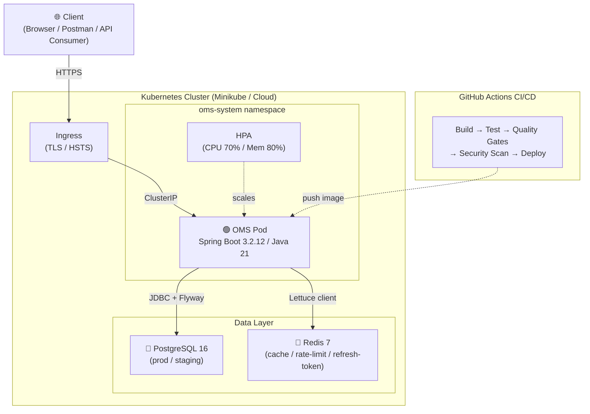
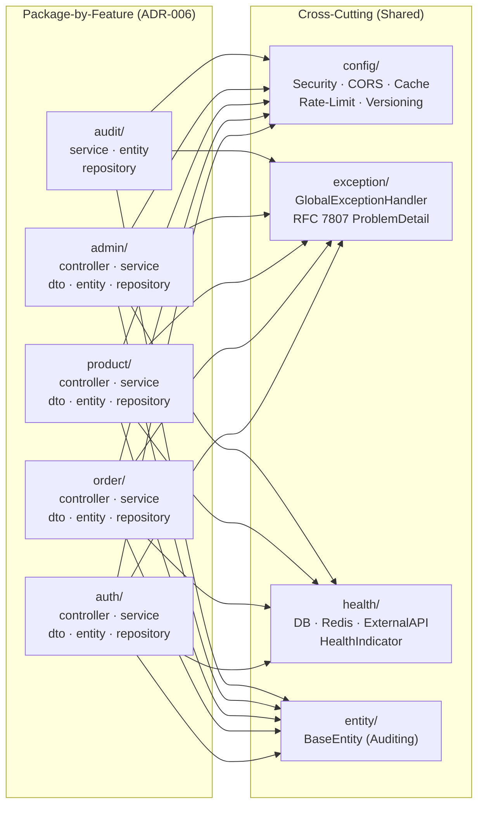

# OMS — Architecture Documentation

> **Status:** Current overview
> **Audience:** Developer, Maintainer, Operator
> **Owner:** Engineering
> **Last verified:** 2026-08-29 (struktur folder, `pom.xml`, dan state V5-P0 by-feature)
> **Source of truth:** `src/main/java/`, `src/main/resources/`, `k8s/`, dan `pom.xml`
> **Version:** 1.1
> **Last Updated:** 29 Agustus 2026

---

## System Architecture Overview

OMS is a monolithic Spring Boot application following a **package-by-feature** architecture (ADR-006, V5-P0):






- **Domain features** (by-feature): `auth`, `order`, `product`, `admin`, `audit` — masing-masing berisi sub-layer `controller`, `service`, `dto`, `entity`, `repository`
- **Cross-cutting infra** (shared): `config`, `exception`, `constant`, `health`, `ratelimit`, `system`, `validation`, `entity` (BaseEntity)
- **API Layer**: Controllers per-feature (Auth, Order, Product, Admin, Version, CSRF)
- **Security Layer**: JWT auth, Rate limiting, CSRF, API versioning
- **Service Layer**: Business logic, orchestration per-feature
- **Repository Layer**: Spring Data JPA + QueryDSL per-feature
- **Data Layer**: PostgreSQL (prod/staging), H2 (dev), Redis (caching + rate limiting + refresh token)

---

## Component Responsibilities

| Component | Responsibility | Technology |
|-----------|---------------|------------|
| Controllers | HTTP handling, validation | Spring MVC |
| Services | Business logic, orchestration | Spring @Service |
| Repositories | Data access, persistence | Spring Data JPA + QueryDSL |
| Security | JWT auth, rate limiting, CSRF | Spring Security + Custom Filters |
| Caching | Product cache, token blacklist | Redis (Lettuce) |
| Health | Custom health indicators | Spring Actuator |

---

## Data Flow: Order Creation

```
Client -> POST /api/v1/orders
  -> ApiVersionFilter (validate version)
  -> JwtAuthenticationFilter (authenticate JWT)
  -> RateLimitInterceptor (check rate limit)
  -> OrderController.createOrder()
    -> OrderService.createOrder()
      -> OrderItemFactory.buildAndValidateItems()
        -> ProductRepository.findById() (validate stock)
      -> OrderRepository.save()
    -> OrderResponse (DTO)
  <- 201 Created
```

## Data Flow: Authentication

```text
Client -> POST /api/v1/auth/login
  -> RateLimitInterceptor (check rate limit -- distributed via Redis or in-memory fallback)
  -> AuthController.login()
    -> AuthenticationManager.authenticate()
    -> JwtTokenProvider.generateToken()
    -> RefreshTokenService.createRefreshToken()
  <- 200 OK { accessToken, refreshToken, tokenType: "Bearer" }
```

---

## Security Architecture

1. **Authentication**: JWT bearer tokens with `token_type` claim (access/refresh); `JwtAuthenticationFilter` rejects refresh tokens on protected endpoints
2. **Token Lifecycle**: Refresh token rotation, replay detection (Redis exact-match), revocation/logout via `RefreshTokenService`
3. **Rate Limiting**: Token bucket algorithm (Bucket4j), per-endpoint limits; distributed mode via `LettuceBasedProxyManager` (Redis-backed) with in-memory fallback
4. **CSRF Protection**: Token-based CSRF for state-changing operations
5. **Input Validation**: @Valid annotations, custom sanitization (SQL injection blocking)
6. **Audit Logging**: Admin operations tracked
7. **Container Hardening**: `readOnlyRootFilesystem`, `allowPrivilegeEscalation: false`, `capabilities.drop: [ALL]`, `seccompProfile: RuntimeDefault`
8. **Network Policy**: Default-deny ingress/egress; allow only required traffic paths
9. **RBAC**: Dedicated ServiceAccount with `automountServiceAccountToken: false`

---

## Deployment Architecture

```text
[Client] -> [Ingress (TLS/HSTS)] -> [Service (ClusterIP)] -> [Pod: oms]
                                                                |
                                                          [PostgreSQL]  [Redis]
```

- **Service**: ClusterIP (not NodePort) — actuator/metrics not exposed on node network
- **HPA**: Auto-scaling (CPU 70%, Memory 80%)
- **PDB**: Min 1 pod available during disruptions
- **ResourceQuota**: Namespace-level caps (CPU/memory/pods/secrets)
- **LimitRange**: Default container resource requests/limits
- **NetworkPolicy**: Default-deny + allow ingress from ingress-nginx, egress to DNS/PostgreSQL/Redis
- **RBAC**: Dedicated ServiceAccount with minimal Role
- **CI/CD**: GitHub Actions with SCA (OWASP), SBOM (CycloneDX), Trivy image scan, Gitleaks secret scan, Kustomize + kubeconform validation
